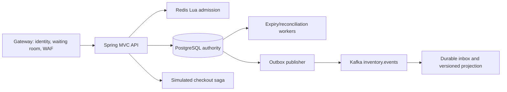
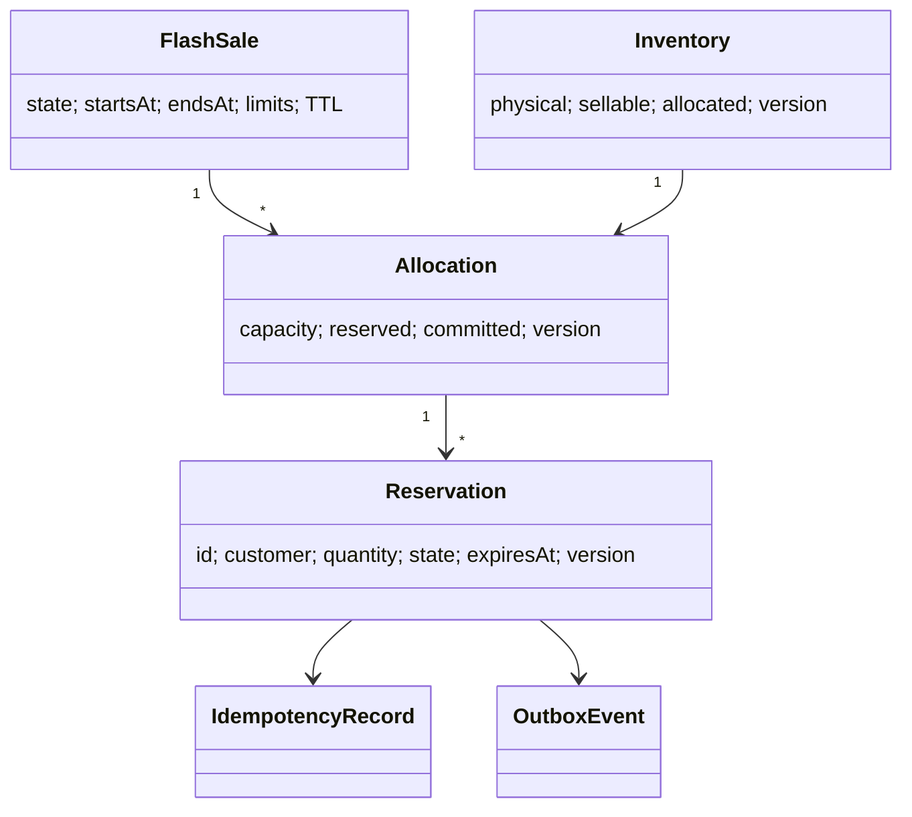

# HLD and LLD

One deployable application with cohesive catalog, reservation, admission, lifecycle, checkout, reconciliation and
messaging services. JDBC expresses exact SQL, locks and affected-row checks without ORM flush surprises. Aggregates:
warehouse inventory, sale, sale stock pool, reservation, customer-sale usage. A Try transaction spans a pool and its
usage/ownership records intentionally: these are not independently consistent microservices.



```mermaid
sequenceDiagram
    participant C as Customer
    participant A as API
    participant R as Redis
    participant P as PostgreSQL
    C ->> A: Try + scoped idempotency key
    A ->> R: Atomic sale/customer window checks
    R -->> A: Permit or reject
    A ->> P: Sale SHARE lock; idempotency claim
 A->>P: Pool lock ; usage conditional update
A->>P: Conditional reserved increment
A->>P: Reservation + ledger + outbox COMMIT
P-->>C: Current durable reservation state
```



## Strategy comparison

| Strategy                     | Correctness / durability                                          | Latency and throughput                                        | Recovery / cost                                                   |
|------------------------------|-------------------------------------------------------------------|---------------------------------------------------------------|-------------------------------------------------------------------|
| PostgreSQL only              | ACID authority with fenced durable primary                        | One hot row serializes; admission still necessary             | Simplest, DB write cost                                           |
| Redis first                  | Single-primary atomic; acknowledged writes may vanish on failover | Fast until hot key saturates                                  | Expensive uncertainty resolution, unsafe as sole strict authority |
| Redis admission + PostgreSQL | Selected baseline; Redis changes load only                        | Reject most traffic before DB; durable commit remains bounded | Fail-closed Redis reduces availability, simpler correctness       |
| Durable preallocated tokens  | Safe if nonoverlapping ownership is fenced in DB                  | Parallel subpools, stock fragmentation                        | Rebalance/reclaim require proof of fencing; deferred              |
| Serialized SKU commands      | Durable owner + inbox dedup protects state                        | Queue absorbs bursts, hot partition remains serial            | Queue lag and rebalances; asynchronous result API needed          |

Readiness is process readiness; DB/Redis outage returns controlled errors and does not cause liveness restarts. Virtual
threads reduce blocking-thread cost; they do not widen database pools or accelerate a contended row.
