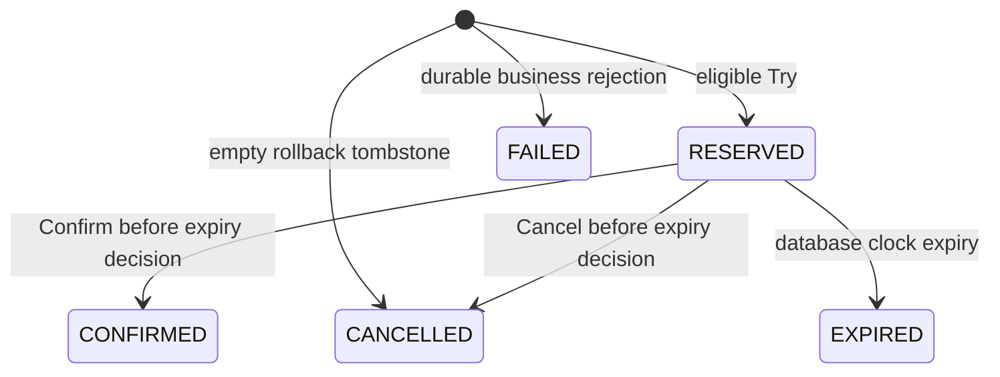

# State machine

CONFIRMED, CANCELLED, EXPIRED and FAILED are terminal. Every terminal request returns the current durable state; clients
must inspect it rather than infer success from HTTP 200. No terminal resurrection. A confirm request on a due hold
expires/releases it instead. Expiry time is sampled using PostgreSQL clock after locking the reservation; the decision
may finish later while waiting for the allocation lock. The policy gives the operation that acquired the reservation and
checked its deadline the linearization decision.

The expiry worker scans at most 100 IDs/second and uses one transaction per ID. Duplicate pods may scan the same ID but
locked state/version makes release once-only. Crashing before commit rolls back; after commit a retry sees terminal
state. Recovery after downtime scans PostgreSQL timestamps; Redis expiry notifications play no role.

Dispatch does not introduce a new reservation status. CONFIRMED remains the historical terminal allocation; a separate
unique fulfillment records its physical dispatch and increments the reservation version. `committed-fulfilled` is
outstanding warehouse ownership. Cancelling or expiring a dispatched reservation still returns CONFIRMED and cannot
restock it. Returns require a separate protocol.
