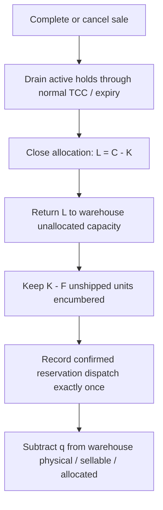

# Pool closure and fulfillment

A sale reaching COMPLETED/CANCELLED stops new purchases but does not automatically close its allocations. Close each
pool explicitly after all holds have confirmed, cancelled or expired. Even an overdue hold blocks close until the
authoritative expiry transition releases it. Pause is reversible and cannot close capacity. No forced hold release is
hidden in close.

Dispatch also works before closure. It records the **whole** reservation quantity; callers cannot supply stock counters
or shipped quantity. Reservation status remains CONFIRMED, its version increments once, and `GET .../fulfillment`
supplies the separate dispatch fact. Existing Try/Confirm/Cancel retries retain their original terminal result.

## API

- `GET /api/v1/admin/allocations/{id}`: ADMIN stock-pool snapshot, including `available`, `encumbered`,
  `committed_outstanding`, `fulfilled`, `released`, `closed_at` and `closed_by`.
- `POST /api/v1/admin/allocations/{id}/close`: ADMIN, no body; allocation UUID is the durable operation identity.
  Repeated calls return the closed snapshot without another release. Returns 409 for a nonterminal sale, active holds or
  divergent reservation counters. Different retrying administrators do not overwrite the first closing actor.
- `POST /api/v1/admin/reservations/{id}/fulfill`: ADMIN with `{"shipmentReference":"shipment-20261115-0001"}`. Reference
  is 8..128 URL-safe characters and globally unique within this single-tenant system. Same reservation/reference returns
  the original fulfillment, preserving its actor/time. Different reference for an already dispatched reservation, or one
  reference reused for a different reservation, returns 409. Unconfirmed/expired/cancelled reservations cannot be
  dispatched.
- `GET /api/v1/reservations/{id}/fulfillment`: reservation owner or ADMIN. Returns 404 before fulfillment or for a
  non-owner; does not reveal another customer's shipment.

Fulfillment response:
`{"reservationId":"UUID","shipmentReference":"shipment-20261115-0001","quantity":1,"actor":"warehouse-operator","fulfilledAt":"2026-11-15T16:00:00Z"}`.
Close/fulfill use their business identities instead of a separate Idempotency-Key. On an ambiguous response, retry that
exact identity; never generate a fresh shipment reference merely because the response was lost.

## Example

A pool has C=100, R=0, K=2, F=0. Closing returns L=98 and leaves warehouse A=2 for these units. Another sale may
allocate only the remaining unencumbered sellable stock. Dispatching the two units then reduces warehouse P/S/A by 2 and
sets F=2. The old pool has C=100, K=2, F=2, L=98, available=0 and encumbered=0. Nothing deducts the historical K again.

## Transactions and races

Try acquires sale SHARE -> idempotency -> pool -> customer usage. Terminal transitions acquire reservation -> pool ->
customer usage. Dispatch acquires reservation -> pool -> warehouse. Close acquires sale SHARE -> pool -> warehouse and
never locks reservations; it checks their MVCC totals while the pool lock prevents an inconsistent commit.
Reconciliation audits pool and warehouse batches in **separate** transactions, never taking a pool lock while holding
warehouse locks. Stock adjustments lock only their warehouse row. All write paths use bounded SQL/network deadlines; a
deadlock/timeout rolls back and is retried using the original identity.

Confirm-versus-close either leaves a protected confirmed unit before closure, or causes close to reject the still-active
hold. Cancel-versus-close cannot subtract a hold twice. Try-versus-sale completion is ordered by sale SHARE/UPDATE
locks; an accepted hold blocks close until drained. Dispatch-versus-close updates F and L under the same pool lock, so
both orders conserve stock. Warehouse reductions and new allocations serialize with dispatch/close on the parent stock
row.

Each operation emits one movement (`FULFILL` or `POOL_CLOSE`) and one outbox fact (`InventoryFulfilled` or
`InventoryPoolClosed`). Fulfillment events use the reservation aggregate and its incremented version; closure uses the
allocation aggregate/version. Consumers must not interpret lifetime committed counts as outstanding warehouse ownership.
A real carrier remains outside this transaction: trusted warehouse integration must deduplicate external dispatch using
its shipment reference and reconcile ambiguous physical outcomes.

## Migration and operations

V4 adds default-zero fulfilled/released counters, nullable closure metadata, durable shipment identities, ledger
uniqueness and audit indexes. Existing V3 confirmed allocations stay fully encumbered until explicitly closed/fulfilled.
V1-V3 are unchanged. The integration test seeds a V3 namespace with confirmed units, upgrades to V4, then closes and
dispatches it.

Use the admin demo controls or the APIs. Do not automatically close every sale on a scheduler or infer dispatch from
checkout/payment success. Partial dispatch, post-confirm cancellation, returns/restocking, and live carrier connectivity
remain unimplemented. No automatic repair or deletion of fulfillment identities is permitted; retain them for shipment
replay and audit. Historical pool/fulfillment totals must not be purged without an archive transfer protocol that
preserves the warehouse cumulative-fulfilled audit.
