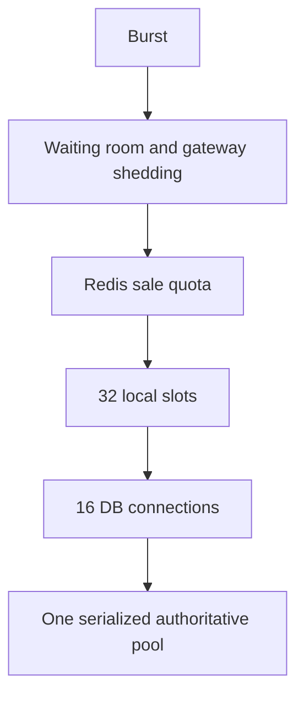
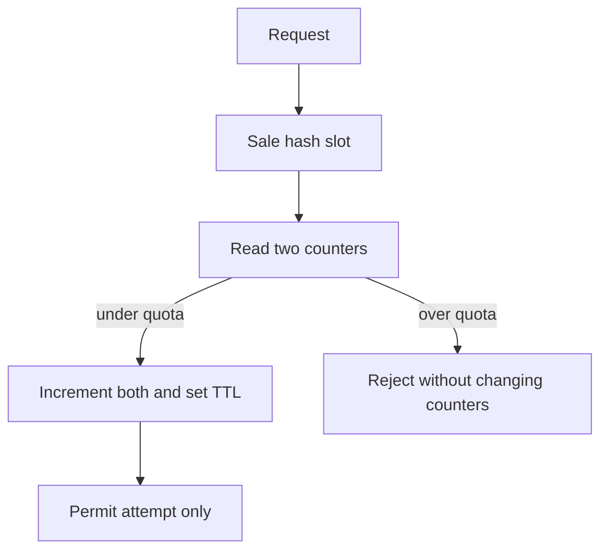
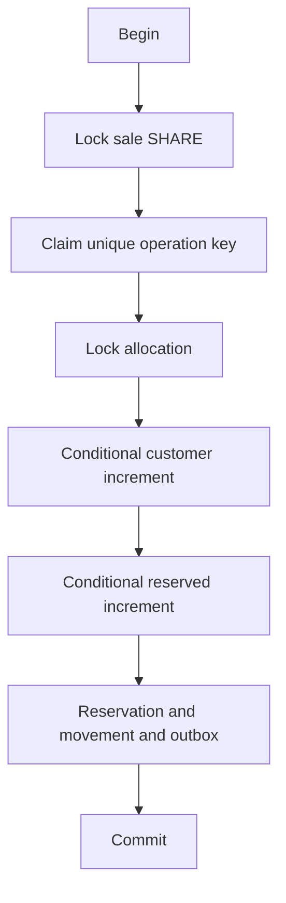
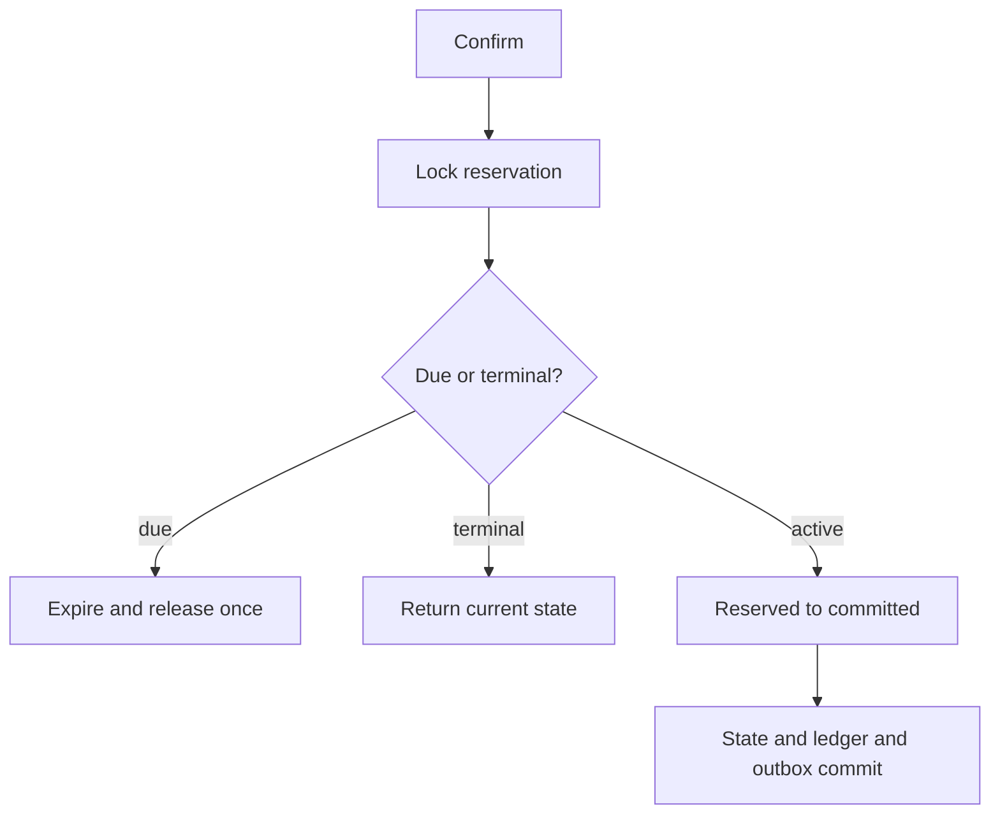
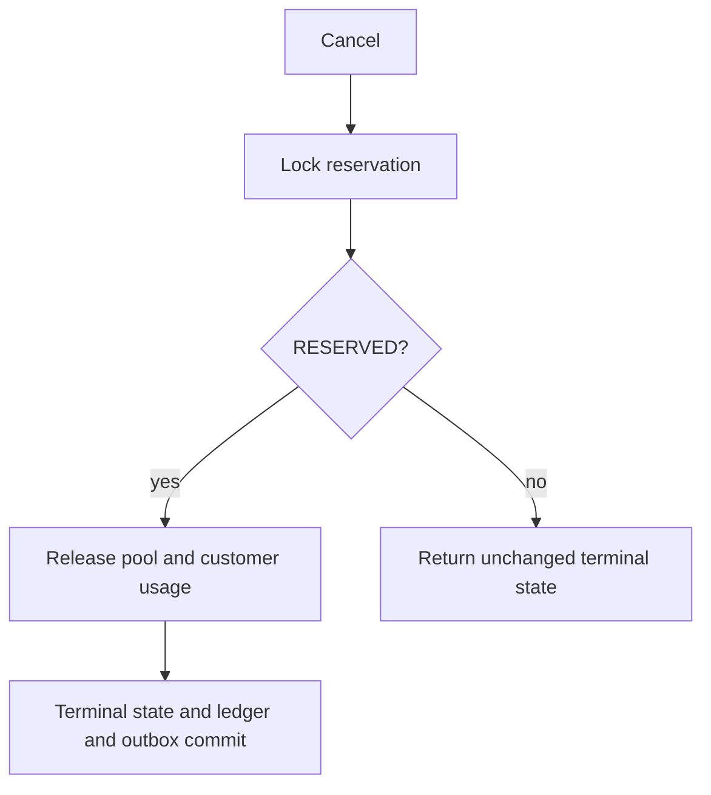
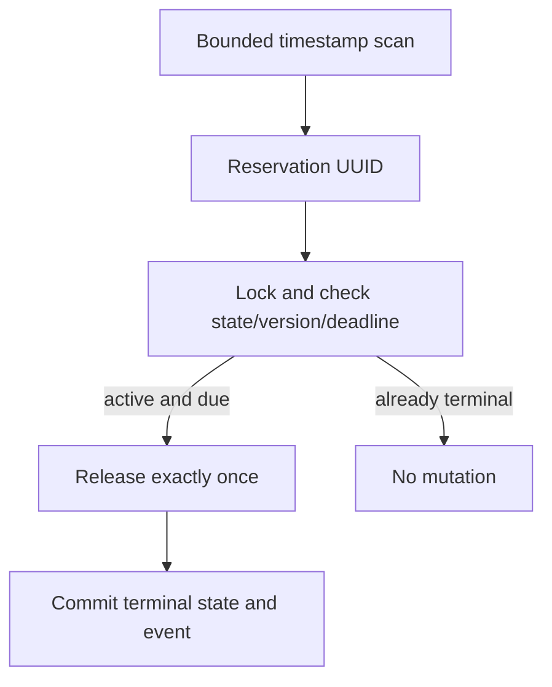
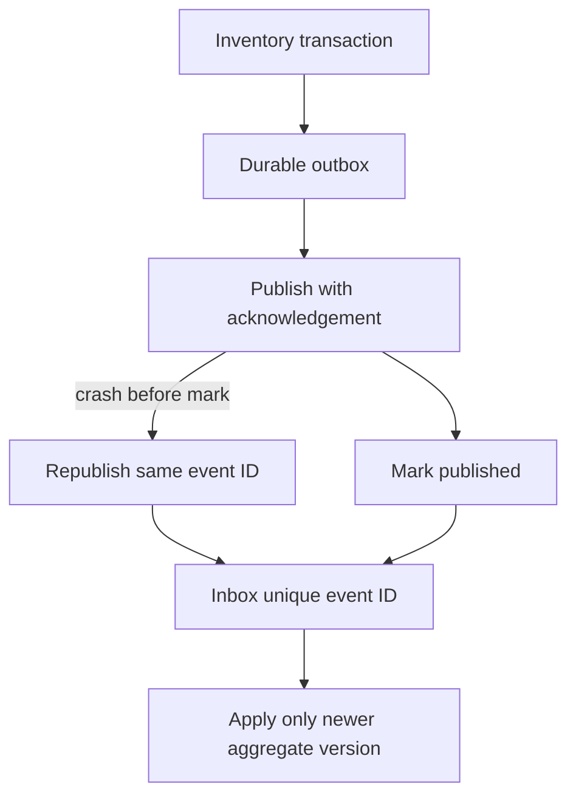
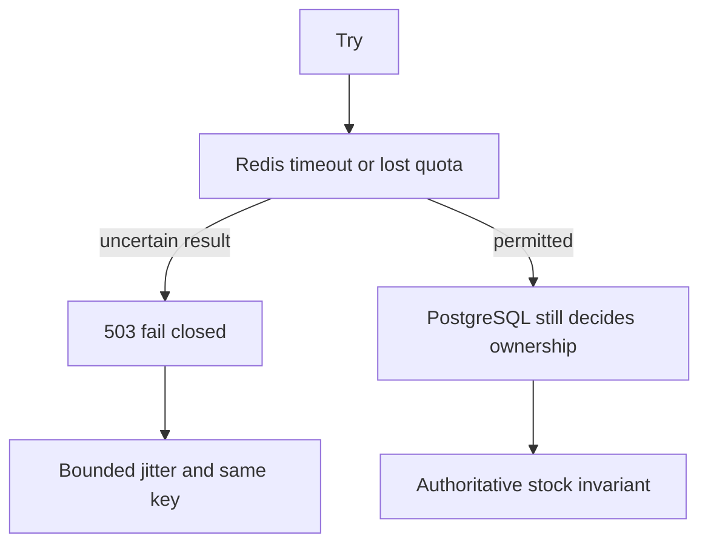
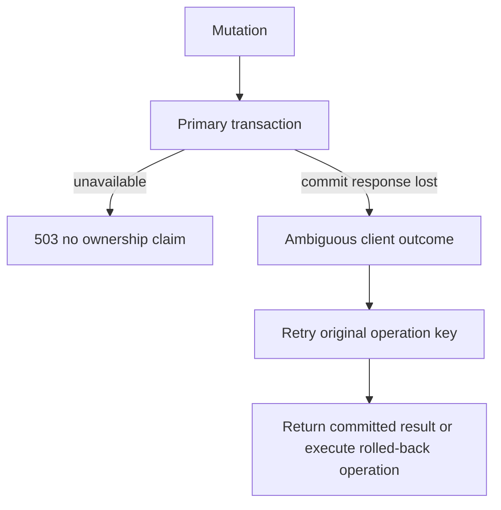
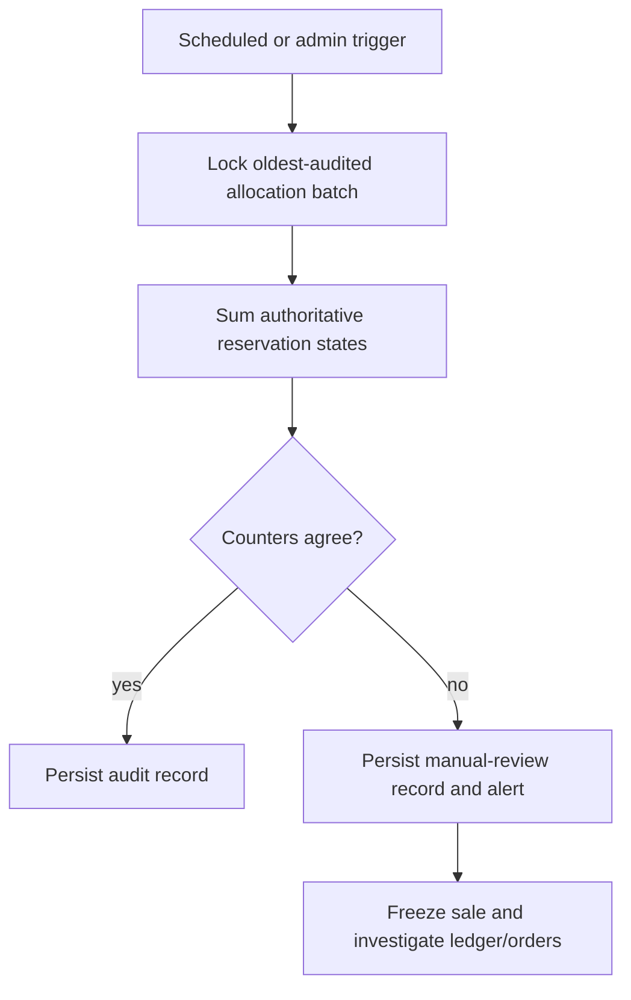

# Detailed operational workflows

These describe implemented baseline paths; gateway waiting-room behavior is a deployment requirement.

## Hot SKU handling

## Redis Lua execution

## PostgreSQL reservation

## Confirmation

## Cancellation

## Expiration

## Kafka processing

## Redis failure

## PostgreSQL failure

## Inventory reconciliation

